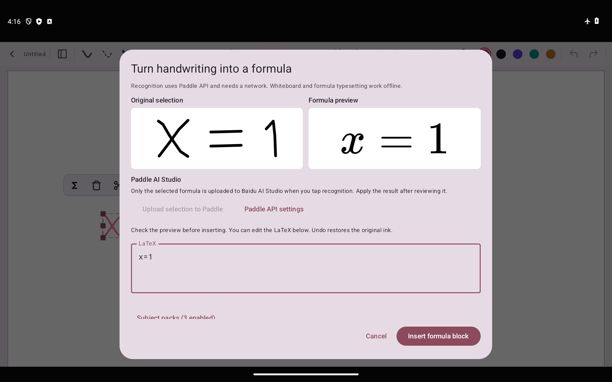

# xnotes LaTeX — Paddle API 轻量白板

面向 Android 平板白板的独立 fork：**套索圈选 → Paddle API 识别 → LaTeX 预览纠错 → 可拖动公式块**，支持分页笔记和无限画布。识别需要联网，白板和公式排版可以离线使用。

- **[下载 v6.1 轻量 APK](https://github.com/Feist-totoo/xnotes-latex/releases/download/v0.9.8-latex.6.1-paddle-lite/xnotes-latex-0.9.8-latex.6.1-paddle-lite.apk)** · [Release](https://github.com/Feist-totoo/xnotes-latex/releases/tag/v0.9.8-latex.6.1-paddle-lite)。**52.4 MB**；Android 8.0+，arm64-v8a / x86_64，沿用签名，可覆盖升级。
- **新增图片直线切块**：导入题目图片，选中后点分叉箭头“直线切块”，划线预览再确认。支持横切、竖切、斜切，每块可独立拖动、继续切割、保存重开和撤销。切块完全本地运行。[操作与验证](docs/IMAGE_SPLIT.md)。
- 已去掉全部本地 OCR 模型、ONNX Runtime 和 GLM/llama.cpp 推理库。没有首次模型下载或本地 OCR 自动加载。
- 圈选公式后在 **Paddle API 设置**填写自己的 AI Studio 令牌。主动点击识别才上传当前选区；结果需手动采用。令牌在本机加密保存，不进入备份。
- 保留白板、LaTeX 空格修复、原生排版、可移动/缩放/编辑公式块、保留原笔迹和撤销。十个学科包作为符号、模板与校对辅助保留，可独立管理；不对 Paddle 结果做本地模型候选评分。
- **v6.1：2524 项 JVM 测试、11 项 Android 检查通过**，含图片像素重建、重复切割、点击拖动、取消、撤销、持久化和原公式流程回归。[v6 的覆盖升级和模型清理记录](docs/FORMULA_PADDLE_LITE.md)保留。未配置真实 AI Studio 令牌，云端准确率和延迟尚未实测。没有三星 / S Pen 真机测试数据。
- [轻量版验证与升级说明](docs/FORMULA_PADDLE_LITE.md) · [使用与构建](docs/FORMULA.md) · [旧离线完整版](https://github.com/Feist-totoo/xnotes-latex/releases/tag/v0.9.8-latex.5.1-full) · [十个独立学科包](https://github.com/Feist-totoo/xnotes-latex/releases/tag/v0.9.8-latex.5-full)。
- 本 fork 代码为 AGPL-3.0，保留原 xnotes MIT 署名。高数、线代包中的历史统计数据遵循 CC BY-NC-SA 4.0，轻量版不使用它们评分。测试图片与用户截图不随应用分发。
- 下方保留上游介绍；商店与上游 Release 不包含此 fork 功能。

<p align="center"><br /><em>交互测试画面：x=1 为手动输入，用于验证排版和编辑流程，不代表云端识别准确率。</em></p>

---

<p align="center">
  
</p>

<p align="center">
  <a href="https://github.com/shardulvs/xnotes-android/releases/latest"></a>
  <a href="https://f-droid.org/en/packages/com.xnotes"></a>
  <a href="LICENSE"></a>
  
  <a href="https://github.com/sponsors/shardulvs"></a>
</p>

<p align="center">
  <a href="https://f-droid.org/en/packages/com.xnotes"></a>
  <a href="https://play.google.com/store/apps/details?id=com.xnotes"></a>
</p>

<p align="center">
  
  <br />
  <em>Annotating a PDF in dark mode, with the pages inverted</em>
</p>

<p align="center">
  
  <br />
  <em>Browsing imported PDFs in the gallery view</em>
</p>

---

## Features

- **Ink that feels like a pen**: pressure-sensitive and low latency, with pens and highlighters.
- **Neon glow**: make any pen glow.
- **Disappearing ink**: ink that fades away on its own, great for teaching and presenting.
- **Tape**: cover answers with tape and tap to peel it back, for testing yourself.
- **Shape snapping**: draw a rough shape, hold, and it snaps clean.
- **Sharp at any zoom**: ink and PDFs stay crisp however far you zoom in.
- **Notebooks and an infinite canvas**: pages when you want structure, endless space when you don't.
- **Book layouts**: single, double or cover pages, scrolling or page flips.
- **PDF import**: bring in any PDF and write all over it.
- **Room for side notes**: widen a PDF's margins on any edge and take notes on the side.
- **Insert space**: drag anywhere on a page to open up room there, even in the middle of a PDF.
- **PDF text markups**: highlight, underline and strike out text, add comments, search it.
- **PDF colour filters**: invert, sepia, contrast, brightness, multiply and screen.
- **Images stay untouched**: filter a PDF and its photos and images keep their true colours.
- **Dark and OLED modes**: easy on the eyes at night, true black on OLED screens.
- **Real PDF export**: sharp vector output with selectable text, links and bookmarks.
- **Markdown**: write in markdown and it formats as you type.
- **Typed notes**: tables, LaTeX equations and code highlighting, right on the page.
- **Audio recording**: record a lecture as you write, and your ink replays in sync with it.
- **20+ page templates**: Cornell, planners, music staves, isometric and more.
- **Endless themes**: any accent colour, eight styles for each, dual tone and Material You.
- **Make it yours**: rearrange the toolbar, float it or dock it on any edge, and pick its size.
- **Split view**: two notes side by side.
- **A real file explorer**: grid, gallery, list, column and timeline views, with plenty to customise.
- **Your notes, your folders**: notes are saved as files in a folder you choose, not locked away in an app's database, so you stay in full control of them.
- **Works with stylus pens**: S Pen and many others.
- **Always editable**: nothing gets flattened, so every stroke can be moved, restyled or erased later.
- **Private**: open source, no account, no ads, no tracking. Whiteboard editing and LaTeX typesetting work offline. Handwriting recognition uses Paddle AI Studio after you explicitly upload a selection; GitHub package updates are optional.

## Install

| Channel | |
|---|---|
| [GitHub Releases](https://github.com/shardulvs/xnotes-android/releases/latest) | Signed APK |
| [F-Droid](https://f-droid.org/en/packages/com.xnotes) | Built reproducibly from source |
| [Google Play](https://play.google.com/store/apps/details?id=com.xnotes) | Automatic updates |

GitHub and F-Droid ship the same signed APK, so you can switch between them without reinstalling.

## Build from source

Needs JDK 21 or 22 (tested with 22), NDK 27.0.12077973 and CMake 3.22.1.

```bash
git clone https://github.com/shardulvs/xnotes-android.git
cd xnotes-android
JAVA_HOME=/path/to/jdk-17 ./gradlew assembleDebug
```
