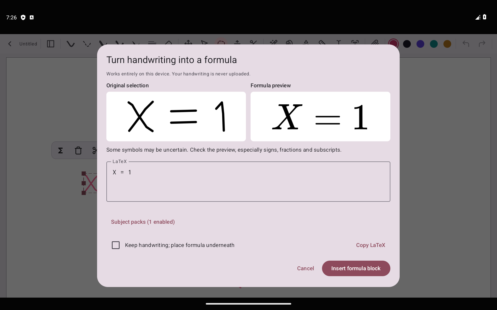
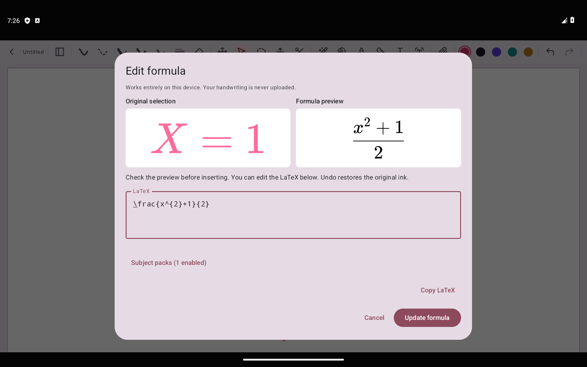
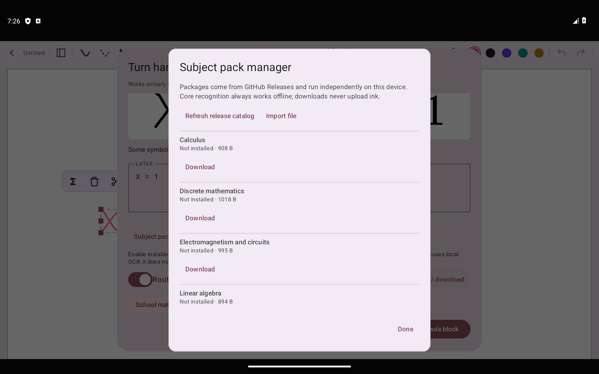

# xnotes LaTeX — 套索手写转可移动公式

这是面向 Android 平板白板的独立 fork。**套索圈选笔画 → 本地 OCR → LaTeX 预览纠错 → 插入可拖动公式块**，支持分页笔记和无限画布。

- 公式保留可编辑源码，可移动、缩放、再次编辑；支持撤销和保留原笔迹。
- 模型内置 APK，识别不联网。十个学科包可从 GitHub Releases 独立下载、启停、更新和本地导入；下载后离线调用。不是整页中文 OCR；每次选择一个数学公式并检查预览。
- 基于 xnotes 原生 Android 画布和完全离线的 GLM-OCR / llama.cpp；此 fork 按 AGPL-3.0 发布，保留原始 xnotes 的 MIT 许可与署名。
- **[使用、构建与许可说明](docs/FORMULA.md)**。构建前运行 `python tools/prepare_glm_formula.py`。
- 真实手写对照与 Android 原生验证见 [识别验证报告](docs/FORMULA_ACCURACY.md)；三星平板 / S Pen 实机表现仍需验证。
- **[新版 APK](https://github.com/Feist-totoo/xnotes-latex/releases/tag/v0.9.8-latex.3)** · **[十个独立学科包](https://github.com/Feist-totoo/xnotes-latex/releases/tag/formula-packs-v1.0.0)**。当前仍需逐式核对，未达到大部分任意手写公式可靠识别的目标。
- 此 fork 的包名与官方版不同。下方保留上游介绍；其中商店和上游 release 链接不包含本 fork 新功能。

<p align="center"></p>
<p align="center"></p>
<p align="center"></p>

---

<p align="center">
  
</p>

<p align="center">
  <a href="https://github.com/shardulvs/xnotes-android/releases/latest"></a>
  <a href="https://f-droid.org/en/packages/com.xnotes"></a>
  <a href="LICENSE"></a>
  
  <a href="https://github.com/sponsors/shardulvs"></a>
</p>

<p align="center">
  <a href="https://f-droid.org/en/packages/com.xnotes"></a>
  <a href="https://play.google.com/store/apps/details?id=com.xnotes"></a>
</p>

<p align="center">
  
  <br />
  <em>Annotating a PDF in dark mode, with the pages inverted</em>
</p>

<p align="center">
  
  <br />
  <em>Browsing imported PDFs in the gallery view</em>
</p>

---

## Features

- **Ink that feels like a pen**: pressure-sensitive and low latency, with pens and highlighters.
- **Neon glow**: make any pen glow.
- **Disappearing ink**: ink that fades away on its own, great for teaching and presenting.
- **Tape**: cover answers with tape and tap to peel it back, for testing yourself.
- **Shape snapping**: draw a rough shape, hold, and it snaps clean.
- **Sharp at any zoom**: ink and PDFs stay crisp however far you zoom in.
- **Notebooks and an infinite canvas**: pages when you want structure, endless space when you don't.
- **Book layouts**: single, double or cover pages, scrolling or page flips.
- **PDF import**: bring in any PDF and write all over it.
- **Room for side notes**: widen a PDF's margins on any edge and take notes on the side.
- **Insert space**: drag anywhere on a page to open up room there, even in the middle of a PDF.
- **PDF text markups**: highlight, underline and strike out text, add comments, search it.
- **PDF colour filters**: invert, sepia, contrast, brightness, multiply and screen.
- **Images stay untouched**: filter a PDF and its photos and images keep their true colours.
- **Dark and OLED modes**: easy on the eyes at night, true black on OLED screens.
- **Real PDF export**: sharp vector output with selectable text, links and bookmarks.
- **Markdown**: write in markdown and it formats as you type.
- **Typed notes**: tables, LaTeX equations and code highlighting, right on the page.
- **Audio recording**: record a lecture as you write, and your ink replays in sync with it.
- **20+ page templates**: Cornell, planners, music staves, isometric and more.
- **Endless themes**: any accent colour, eight styles for each, dual tone and Material You.
- **Make it yours**: rearrange the toolbar, float it or dock it on any edge, and pick its size.
- **Split view**: two notes side by side.
- **A real file explorer**: grid, gallery, list, column and timeline views, with plenty to customise.
- **Your notes, your folders**: notes are saved as files in a folder you choose, not locked away in an app's database, so you stay in full control of them.
- **Works with stylus pens**: S Pen and many others.
- **Always editable**: nothing gets flattened, so every stroke can be moved, restyled or erased later.
- **Private**: open source, no account, no ads, no tracking, no internet access.

## Install

| Channel | |
|---|---|
| [GitHub Releases](https://github.com/shardulvs/xnotes-android/releases/latest) | Signed APK |
| [F-Droid](https://f-droid.org/en/packages/com.xnotes) | Built reproducibly from source |
| [Google Play](https://play.google.com/store/apps/details?id=com.xnotes) | Automatic updates |

GitHub and F-Droid ship the same signed APK, so you can switch between them without reinstalling.

## Build from source

Needs JDK 17, NDK 27.0.12077973 and CMake 3.22.1.

```bash
git clone https://github.com/shardulvs/xnotes-android.git
cd xnotes-android
JAVA_HOME=/path/to/jdk-17 ./gradlew assembleDebug
```
