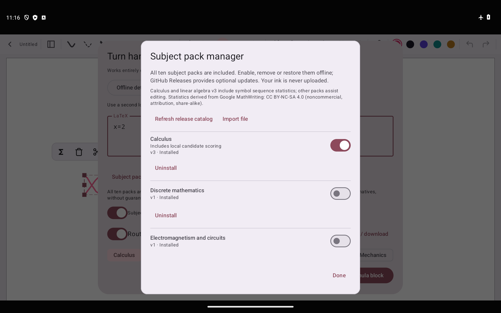
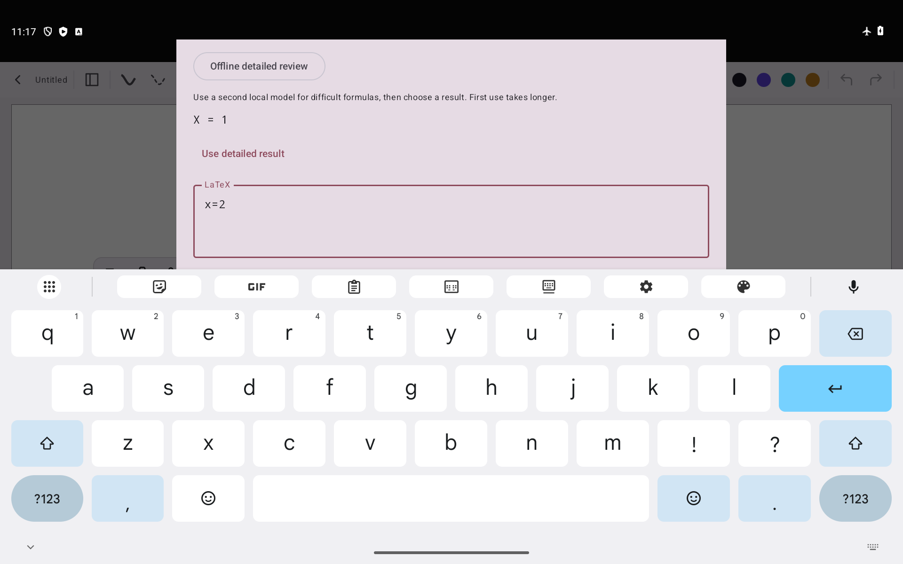

# xnotes LaTeX — 套索手写转可移动公式

面向 Android 平板白板的独立 fork：**套索圈选笔画 → 本地识别 → LaTeX 预览纠错 → 插入可拖动公式块**，支持分页笔记和无限画布。

- **[下载 v5.1 完整 APK](https://github.com/Feist-totoo/xnotes-latex/releases/download/v0.9.8-latex.5.1-full/xnotes-latex-0.9.8-latex.5.1-full.apk)** · [Release / 十个独立学科包](https://github.com/Feist-totoo/xnotes-latex/releases/tag/v0.9.8-latex.5-full)。约 1.01 GB，Android 8.0+，arm64-v8a / x86_64；沿用此 fork 的签名，可覆盖升级。
- **v5.1 新增**：修复公式多余空格；可选 Paddle 官方 AI Studio API，令牌在应用内加密保存，主动点击才上传当前选区。默认保持离线；云端准确率尚未实测。[使用与验证说明](docs/FORMULA_PADDLE.md)。
- APK 内置 GryphOne Q8 快速笔画识别、压缩 GLM-OCR 图片识别 / 精细复核，以及全部十个学科包。安装后不需要下载模型或学科包就能断网使用；包仍可独立启停、卸载、本地恢复、导入和通过 GitHub 更新。
- 原始笔画先快速识别，需要时点“离线精细复核”，检查后手动采用结果；也可选择单张公式图片识别。复核不会覆盖手动编辑。公式源码可再次编辑，块可移动、缩放、撤销或保留原内容。
- **准确率仍有限**：开发机同组 200 条真实样本由 v3 的 89/200 改善到 104/200；Android 新增 160 条为 95/160。高数、线代包改用训练集符号序列统计，旧专项集 116→117/200，新增集没有增益。不能宣称对大多数本科公式已可靠；发布标记为 prerelease，保留 v3 稳定渠道。
- [完整验证报告](docs/FORMULA_ACCURACY_V5.md) · [使用、构建与许可](docs/FORMULA.md)。构建前运行 `python tools/prepare_full_formula.py`。没有三星 / S Pen 真机测试数据。
- 此 fork 代码为 AGPL-3.0，保留原 xnotes MIT 署名。高数、线代统计资源源于 Google MathWriting HUMAN TRAIN，遵循 **CC BY-NC-SA 4.0**；原始笔迹、测试图片和用户截图不随应用分发。其余八个学科包是编辑辅助，并非八个另行训练的 OCR 模型。
- 下方保留上游介绍；商店和上游 Release 链接不包含此 fork 功能。

<p align="center"></p>
<p align="center"><br /><em>交互测试：合成 x=1 被快速模型读作 χ=1、精细模型读作 X=1，均非正确。图中 x=2 是人工输入，用于验证复核不会覆盖编辑。</em></p>

---

<p align="center">
  
</p>

<p align="center">
  <a href="https://github.com/shardulvs/xnotes-android/releases/latest"></a>
  <a href="https://f-droid.org/en/packages/com.xnotes"></a>
  <a href="LICENSE"></a>
  
  <a href="https://github.com/sponsors/shardulvs"></a>
</p>

<p align="center">
  <a href="https://f-droid.org/en/packages/com.xnotes"></a>
  <a href="https://play.google.com/store/apps/details?id=com.xnotes"></a>
</p>

<p align="center">
  
  <br />
  <em>Annotating a PDF in dark mode, with the pages inverted</em>
</p>

<p align="center">
  
  <br />
  <em>Browsing imported PDFs in the gallery view</em>
</p>

---

## Features

- **Ink that feels like a pen**: pressure-sensitive and low latency, with pens and highlighters.
- **Neon glow**: make any pen glow.
- **Disappearing ink**: ink that fades away on its own, great for teaching and presenting.
- **Tape**: cover answers with tape and tap to peel it back, for testing yourself.
- **Shape snapping**: draw a rough shape, hold, and it snaps clean.
- **Sharp at any zoom**: ink and PDFs stay crisp however far you zoom in.
- **Notebooks and an infinite canvas**: pages when you want structure, endless space when you don't.
- **Book layouts**: single, double or cover pages, scrolling or page flips.
- **PDF import**: bring in any PDF and write all over it.
- **Room for side notes**: widen a PDF's margins on any edge and take notes on the side.
- **Insert space**: drag anywhere on a page to open up room there, even in the middle of a PDF.
- **PDF text markups**: highlight, underline and strike out text, add comments, search it.
- **PDF colour filters**: invert, sepia, contrast, brightness, multiply and screen.
- **Images stay untouched**: filter a PDF and its photos and images keep their true colours.
- **Dark and OLED modes**: easy on the eyes at night, true black on OLED screens.
- **Real PDF export**: sharp vector output with selectable text, links and bookmarks.
- **Markdown**: write in markdown and it formats as you type.
- **Typed notes**: tables, LaTeX equations and code highlighting, right on the page.
- **Audio recording**: record a lecture as you write, and your ink replays in sync with it.
- **20+ page templates**: Cornell, planners, music staves, isometric and more.
- **Endless themes**: any accent colour, eight styles for each, dual tone and Material You.
- **Make it yours**: rearrange the toolbar, float it or dock it on any edge, and pick its size.
- **Split view**: two notes side by side.
- **A real file explorer**: grid, gallery, list, column and timeline views, with plenty to customise.
- **Your notes, your folders**: notes are saved as files in a folder you choose, not locked away in an app's database, so you stay in full control of them.
- **Works with stylus pens**: S Pen and many others.
- **Always editable**: nothing gets flattened, so every stroke can be moved, restyled or erased later.
- **Private**: open source, no account, no ads, no tracking. This fork recognizes offline by default. Networking is opt-in: GitHub package downloads or explicitly uploading a selected formula to Paddle AI Studio.

## Install

| Channel | |
|---|---|
| [GitHub Releases](https://github.com/shardulvs/xnotes-android/releases/latest) | Signed APK |
| [F-Droid](https://f-droid.org/en/packages/com.xnotes) | Built reproducibly from source |
| [Google Play](https://play.google.com/store/apps/details?id=com.xnotes) | Automatic updates |

GitHub and F-Droid ship the same signed APK, so you can switch between them without reinstalling.

## Build from source

Needs JDK 21 or 22 (tested with 22), NDK 27.0.12077973 and CMake 3.22.1.

```bash
git clone https://github.com/shardulvs/xnotes-android.git
cd xnotes-android
JAVA_HOME=/path/to/jdk-17 ./gradlew assembleDebug
```
