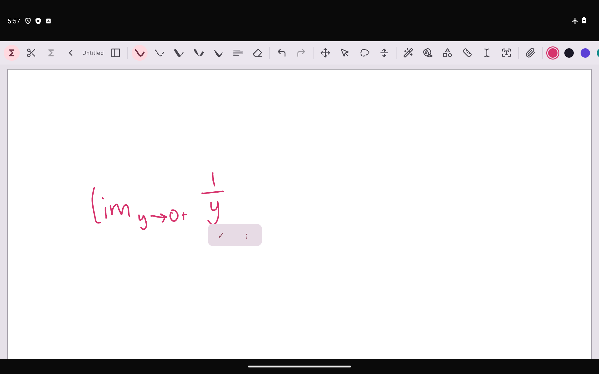
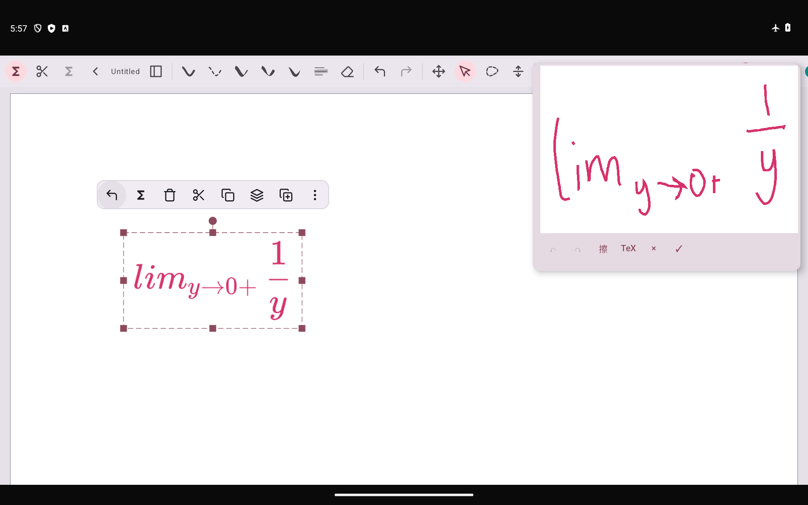
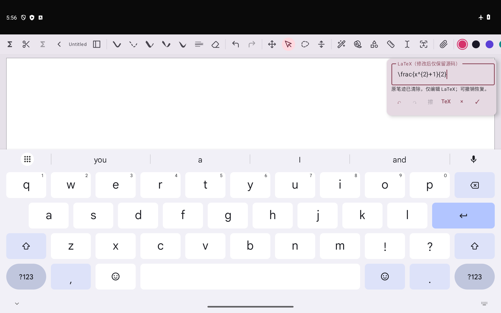

# v9：确认式原位排版与原笔迹编辑

顶部 Σ 启用后，停笔只在最后落笔附近出现两个按钮，不运行 OCR、不替换笔迹。

- ✓：对当前批次做一次本地识别并原位排版；等待期间继续书写会取消旧结果。
- ；：当前笔迹保留在白板，下次书写开启新批次。这个分段动作可以用白板撤销/恢复。
- 自由套索选中笔迹后，可点顶部「渲染选中笔记」或选中菜单 Σ 进入识别与排版。

选中已有公式，点「修改原笔记」，右上角打开草稿小窗。书写区域以当前选中块的屏幕尺寸 150% 为目标，并为可操作性与屏幕边界设定最小/最大尺寸；左、下留出边距。可补写、擦除，使用 ↶/↷ 撤销和恢复草稿操作；✓ 识别并替换本次修改，× 取消。未确认的草稿不会改动白板。

TeX 开关显示 LaTeX 输入。仅打开开关不会删除原笔迹；实际修改文本时，草稿转为源码模式并清除其手写来源。可在草稿内撤销恢复，确认后仍可用白板撤销恢复上一版公式与笔迹。没有原笔迹的旧公式以源码模式编辑。

撤销/恢复默认在从左到右第三组：文档入口、所有笔、撤销/恢复。升级时只迁移匹配旧默认顺序的工具栏，用户自定义顺序保持。

## 缓存与执行

停笔不再触发模型推理或图片生成，避免连续书写时反复取消和启动识别。当前批次增量维护范围与采样总数；确认时冻结输入，后台推理和排版；只有文档、笔迹快照和任务版本仍匹配时提交。生成 PNG 后及时回收位图，失败或取消则删除临时图片。草稿撤销最多保留 100 次。

替换前后同步清理前缓冲持有的旧笔迹、湿笔迹网格和交接状态，分页只失效目标页缓存，避免下一笔重新显示被替换的内容。模型继续复用现有本地会话及其闲置释放机制。

保持离线模型与十个学科包不变，本次不声明准确率提升。模拟器测试不能代替三星/S Pen 真机上的闪烁与流畅度验证。

## 界面与验证

测试明细与最终 APK 校验和见 [测试报告](benchmarks/v9-confirm/TEST-REPORT.json)。
