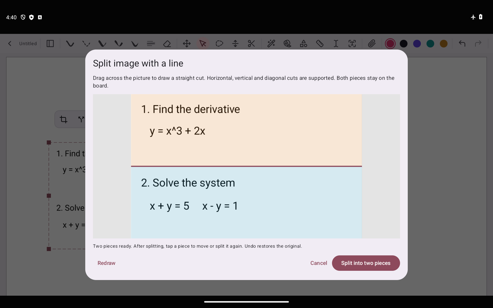
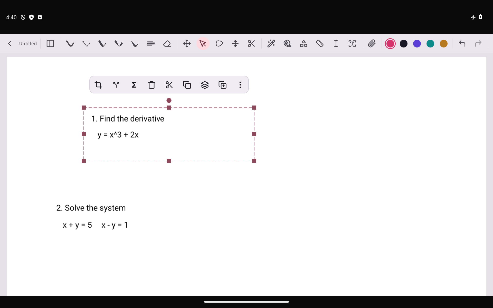

# 图片直线切块 v6.1

2026-11-13，版本 `0.9.8-latex.6.1-paddle-lite`，versionCode 76。仍为 Paddle API 轻量版，APK 52.4 MB，保留原签名和应用 ID，可直接覆盖安装 v6。

## 使用方法

1. 导入用于讲题的图片，用选择工具点选一张图片。
2. 点浮动工具栏中的分叉箭头 **直线切块**，在预览图上拖动划出切线。
3. 两侧以浅色显示，线会延伸到图片边缘；可以重新划线，也可以取消。
4. 点 **切成两块**。两块留在原位置，互不分组，点击任一块可独立移动或缩放。
5. 选中任意一块，再次使用直线切块，可以继续分成更多块。每一刀对应一次撤销。

支持横线、竖线和任意方向的斜线，兼容图片原有旋转、镜像和裁剪。分页笔记和无限画布均支持，切割、预览、保存和导出完全在本机完成。公式块保留 LaTeX 编辑入口，不提供图片切割。

## 数据与边界

切割生成透明 PNG，每块只包含自己的像素，斜线外侧透明。原图片不被覆盖；撤销恢复原对象。保存时写入普通图片资源与可选的 `cut_outline` 点击边界；当前版本重开、复制、旋转、镜像和裁剪后均保留正确点击区域。旧版本即使不认识边界字段，仍能显示 PNG 的透明切块。

为限制平板内存，生成切块时最长边最多 4096 像素、总像素最多 800 万；更大的图片按比例缩小。SVG 输入切块后也成为 PNG。正常尺寸的位图不放大，切割掩码将每个像素分配给且仅分配给一侧，避免切线处丢失内容。没有穿过可见块、沿边划线、轻点或生成完全透明的一侧时不提交结果。

生成在后台执行，提交前核对原文档与图片是否仍未改变。错误、取消、过期结果不修改原图；文件生成失败会清理该次生成的临时块。切块互不绑定成组，原笔记中其他项目与层级顺序保持。

## 验证

- 2524 项 JVM 测试通过，包括新增加的面积守恒、连续切割、旋转/镜像/裁剪后的点击映射、复制与裁剪撤销、两种笔记格式保存重开。
- 最终签名 APK 上 11 项 Android 检查通过：3 项图片像素与变换检查、8 项真实编辑器流程检查。使用内置测试生成的题目图走实际图片导入入口，再操作划线、取消、切割、拖动、再次切割、撤销和重做；同时回归公式空格排版与可拖动公式块。
- 对横切、竖切和斜切的 PNG 逐像素重新拼合，确认重建等于原图，且没有重叠像素。旋转、镜像、已有裁剪、透明空块失败和源文件未改动检查通过。
- 模拟器开启飞行模式。切块不依赖 Paddle 或任何网络服务；本次没有测量云端识别准确率。
- 签名、16 KiB ZIP 对齐、无本地 OCR 权重/运行库验证通过。未进行三星 / S Pen 真机测试。

[机器验证记录](benchmarks/v6.1-image-split/verification.json)。
