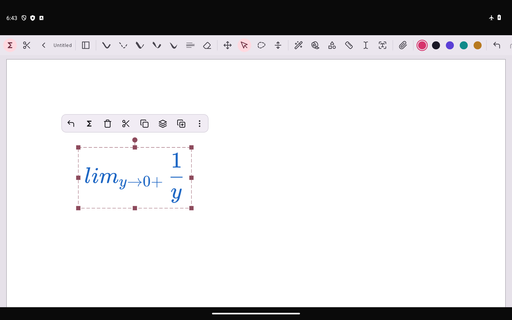
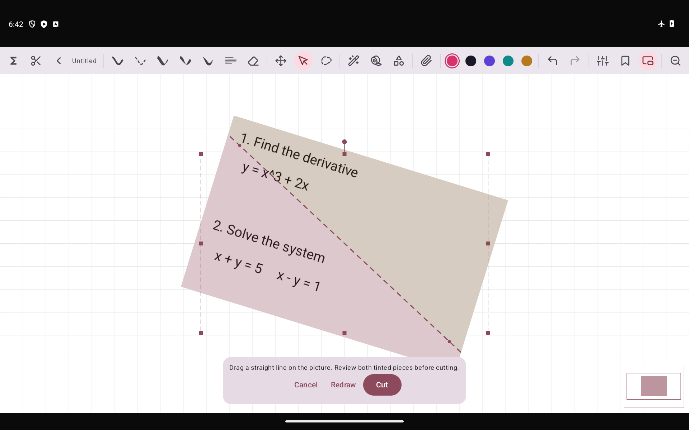

# v8：白板原位公式与图片内切线预览

## 操作

1. 沿用已下载的离线数学包；未安装时，在「偏好设置 → 离线 OCR 设置」下载一次 32.2 MB 模型。随后可以断网识别。
2. 点击顶部 **Σ「停笔转公式」**，按钮高亮后直接在白板写公式。停笔达到设置的等待时间后开始本地识别，在这批笔迹所在位置替换为可拖动的公式块。没有手写侧栏。关闭 Σ 后按普通白板书写。
3. 公式采用这批输入最后一笔的颜色；普通新输入换颜色会开启新的一批。分页笔记和无限画布均支持。
4. 用选择工具选中公式块，点 **「还原手写」**。恢复原始笔迹、压力和颜色，移动、缩放、旋转后的块会在当前几何位置恢复；保存再打开也能还原。还原后先保留笔迹，下一笔续写才再次识别；橡皮擦留下的片段会参与后续识别。选中后的 Σ 仍可手动修改 LaTeX。
5. 选中图片，点顶部或选中菜单的 **剪刀**。直接在可见图片上按下并拖出直线，线延伸到图片边缘；两侧显示当前主题主色与第三色、alpha=0.30 的蒙版。下方小操作条可取消、重画、确认，不打开独立对话框。
6. 确认后得到两个独立图片块，可移动、再次切分、撤销/重做。旋转图片和已切片图片也支持。截图工具从工具栏及其配置列表隐藏。

## 识别与数据

- 停笔等待、快速/均衡/精细模式、CPU 线程、学科包辅助排序仍在偏好设置里调整。自动转换由工具栏 Σ 控制。
- 继续落笔会取消旧识别；新触摸、切换工具、撤销、切换笔记等不会让过时的识别结果覆盖当前内容。识别或排版失败保留手写。被识别的单批最多 256 笔、100,000 个采样点。
- 公式块中新增可选 `latex_ink` 元数据，分页与无限画布的 ZIP 格式均保存原笔迹与参考矩形。旧版生成、没有原笔迹数据的公式块只能修改 LaTeX，不能恢复从未保存的笔迹。
- 新版可直接覆盖 v7，沿用安装签名和离线包，不含 Paddle、账号密钥或云端上传识别。APK 内不含模型权重或测试笔迹。
- 模型、量化、解码与学科包未改。这次是交互与恢复能力更新，不代表准确率提升。v7 的 160 条真实高数/线代样本结果为 95/160；历史速度与准确率见 [v7 测试说明](OFFLINE_MATH_SIDEBAR.md)。

## 验证

在 Android 14、x86_64、2 vCPU / 4 GB RAM 模拟器上断网安装最终签名 APK 测试。没有三星/S Pen 真机验证。结果记录于 [TEST-REPORT](benchmarks/v8-inline/TEST-REPORT.json)。

- JVM：原笔迹冻结、平移/缩放/旋转还原、两种笔记格式往返、分批、恢复等待与擦除片段追踪、截图入口隐藏。
- Android：真实 MathWriting 笔迹经过分页白板的触笔事件入口，验证停笔原位替换、PNG 像素颜色、ZIP/PNG 保存重读、移动后还原、续写转换、撤销/重做；无限画布验证同一真实样本的离线转换。
- 图片：工具栏插入图片、原位切线预览、取消、移动、再次切分、旋转图片、像素重建与无重叠、撤销/重做。
- 已有 LaTeX 空格、套索转换、学科包和原生推理取消回归继续保留。

真实笔迹的交互回放只用于验证流程，不是新的识别准确率基准；未把单一样本成功渲染当作整体识别准确率。

