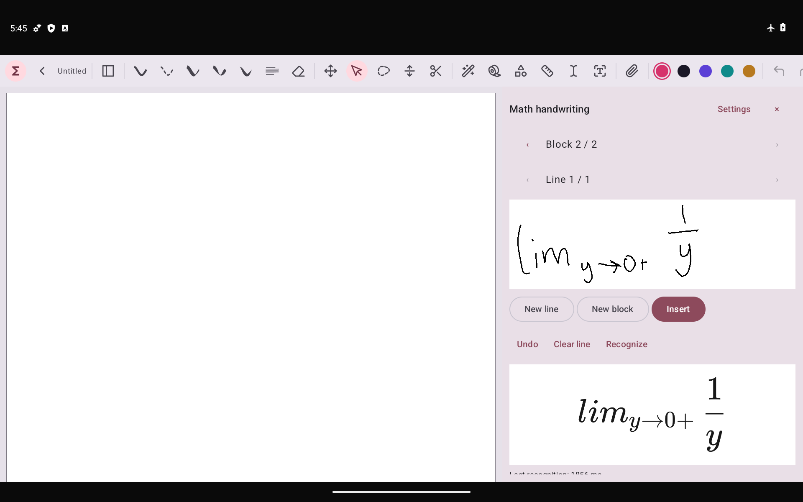

# v7：离线手写侧栏与图片插入修复

识别完全改为本机 ONNX 推理，移除 Paddle 接口、设置和上传入口。安装 APK 后需主动到偏好设置下载一次约 32.2 MB 的离线数学包，之后断网即可识别。模型为已有 GryphOne Q8 导出权重；本版主要改善输入流程、可配置速度和插入可靠性，没有重新训练模型。

## 操作

1. 打开偏好设置中的“离线 OCR 设置”，下载离线包。下载来自本项目 GitHub Release，两份权重在安装前分别校验长度和 SHA-256。校验/修复会复用已验证文件。
2. 打开白板，点工具栏 **Σ（数学手写侧栏）**。上方写一行，停笔后下方自动预览；可直接修改当前行的 LaTeX。
3. **换行**：完成当前行后，在同一公式块中继续；预览合成为多行公式。
4. **换块**：保留现有块为草稿，新建下一块。左右箭头可回到已有行/块。
5. **插入**：插入当前块，与图片调用同一个 `insertImageData` 入口。分页笔记使用当前页默认中心位置并滚动到选中项；无限画布使用可见区域中心。之后可拖动、缩放、编辑 LaTeX、撤销和保存。

关闭侧栏保留当前编辑器中的草稿。未插入的侧栏草稿目前不跨进程保存，请在退出应用前插入白板并保存笔记。最多 16 行/块、32 块；识别失败和插入失败均不清空手写草稿。

## 设置和响应策略

- 自动识别开关；关闭后点“识别”按钮运行。
- 快速：1 个候选、10 轮；均衡：2 个候选、20 轮；精细：4 个候选、20 轮，默认精细。
- 停笔等待 250～1500 ms，默认 550 ms；CPU 线程 1～4，默认 2。
- 学科包辅助候选排序：使用已启用、带兼容识别先验的包。现有高数/线代包能对接近的视觉候选重排，其他包提供符号与模板。不能强行把笔迹改成模板，也不能弥补模型未识别出的结构。
- 开始下一笔即取消上一轮；结果绑定笔迹版本，旧识别结果不能覆盖新笔迹或手动修正。切回已经识别过的行直接复用结果。
- 模型和会话复用，串行推理，不阻塞书写线程；闲置两分钟释放会话。解码各轮有取消检查。首次识别需校验并载入模型，通常比后续慢。
- 排版完全本地。实际预览时间是停笔等待 + 推理 + 排版，并非每个落笔点即时识别。

## 工具栏插入图片

原选择器目的地仅由 `remember` 保存，Activity 重建会丢失；分页图片读取还会在回调中完整加载字节。改为保存可序列化的目标笔记、面板和位置；取得 URI 后在后台流式复制，等待目标视图就绪，再通过公共入口插入。图片立即被选中，分页笔记自动滚动到插入位置。

用户取消选图不插入内容；换了文档、读取失败、图片无效时提示错误且清理新建临时文件。仍保留上一版的图片直线切块功能。

## 验证与限制

最终签名 APK 通过 19 项 Android 回归，另有 2523 项 JVM 测试通过。实际从公开 GitHub Release 下载、校验模型后关闭 Wi-Fi/移动数据，系统报告 `Active default network: none`，再运行所有识别。

固定 v5 高数/线代确认集各 80 条，共 160 条：精细模式结构匹配 **95/160（59.4%）**，高数 49/80、线代 46/80。热运行引擎计时中位数 1508 ms，P95 4706 ms。这里复用历史测试集，不是新发现的未见样本，不能直接和旧的 89/200 比较，也没有证明模型准确率提高。

最终 APK 用同一固定 20 条子集复测三档；精细档的全部预测与上面的 160 条运行对应结果一致：

| 模式 | 热运行引擎中位数 | 结构匹配 |
| --- | ---: | ---: |
| 快速 | 461 ms | 10/20 |
| 均衡 | 923 ms | 10/20 |
| 精细 | 1522 ms | 10/20 |

20 条不足以判断各档整体准确率相同。计时不含停笔等待、学科候选重排和预览排版；默认还需等待停笔 550 ms。原始逐条结果与签名信息见 [TEST-REPORT](benchmarks/v7-offline-sidebar/TEST-REPORT.json)。



设备验证使用 Android 14、x86_64、2 vCPU、4 GB RAM 模拟器，没有三星/S Pen 真机测量。固定真实 MathWriting 样本及逐条结果记录在 `docs/benchmarks/v7-offline-sidebar/`，样本笔迹文件不进入 APK，也不上传到识别服务。三档推理参数预先固定，测试集不用于调参或训练。

真实手写识别仍会错，尤其是复杂矩阵、下标、分式和相近符号。速度测试不能等同于所有平板性能，结构匹配率也不是语义等价率。界面会保留校对入口，不承诺实时或普遍高准确率。

APK 包含白板、原生 LaTeX 排版、ONNX 运行库和十个小型学科资源包，不包含 OCR 权重、GLM/llama.cpp、Paddle 提供方或测试笔迹。下载权重继续复用 [v5 模型 Release](https://github.com/Feist-totoo/xnotes-latex/releases/tag/v0.9.8-latex.5-full)。

## 构建与复测

```powershell
./gradlew.bat :app:testDebugUnitTest :app:assembleDebug :app:assembleDebugAndroidTest
python tools/verify_offline_sidebar.py path/to/final.apk --report path/to/packaging.json
```

Android 测试入口：`FormulaWorkflowTest`（实际 toolbar/ActivityResult/ContentResolver 返回链路、侧栏、公式和切图回归；选择结果由 ActivityMonitor 提供 FileProvider URI，不代表三星图库实机），`OfflineMathTest#downloadAndVerifyModelFromPublicGitHubRelease`（实际公开下载和校验），`OfflineMathTest#benchmarkRealHandwritingOffline`（外部真实样本），`OfflineMathTest#settingsRoundtripAndNativeCancellationLeaveEngineUsable`。

通过 `adb push` / `run-as` 将本地 `app/src/androidTest/assets/handwriting-v5` 复制到测试应用 `files/handwriting-v5`，运行基准时指定 `-e mathCount 160 -e mathMode ACCURATE`；快速和均衡使用同一固定子集 `mathCount 20`。下载验证后关闭 Wi-Fi、移动数据，再运行识别。输出 JSON 在应用 external files 路径，可用 `tools/score_formula_structure.py` 按原有保守 MathML 指标评分。

许可证：fork AGPL-3.0，原 xnotes MIT 署名保留；模型/运行库许可证与通知在 `assets/offline-math`。MathWriting 来源的高数/线代先验继续按 CC BY-NC-SA 4.0 使用。
